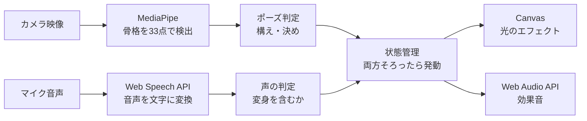
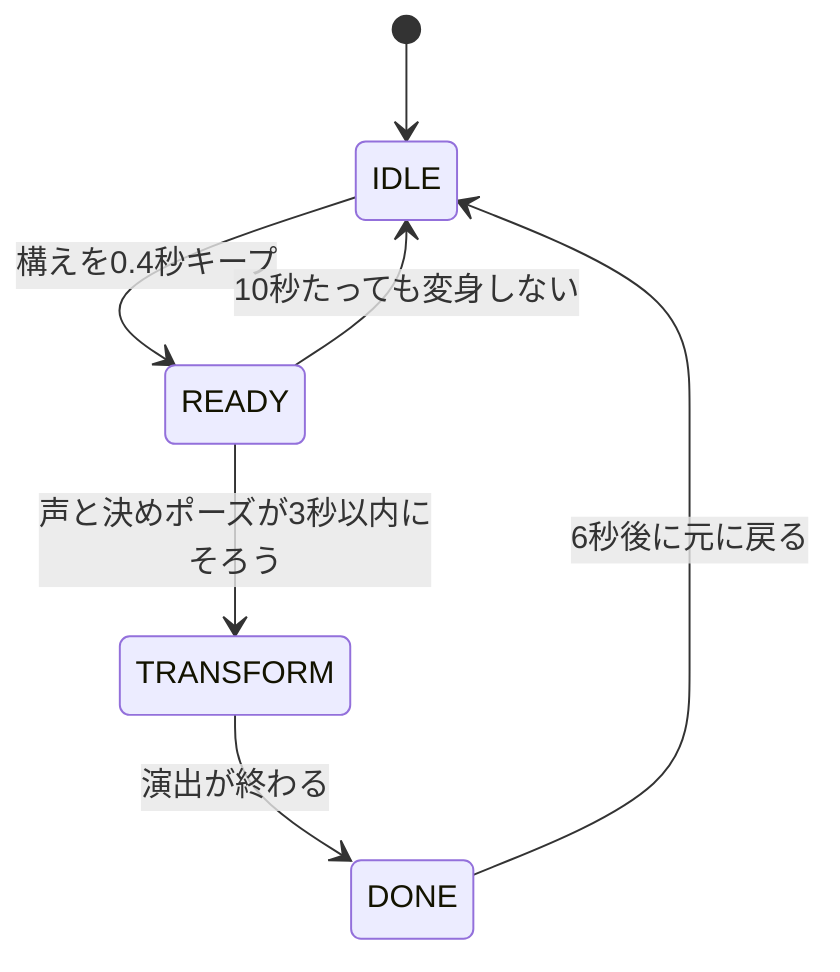

# 変身体験システム 試作 v0.2

声とポーズで「変身」すると、画面に映った自分に光のエフェクトが出るWebアプリの試作です。
スマートフォンやPCのブラウザで、アプリをインストールせずに動きます。

- 作成：柳川甲斐（法政大学 デザイン工学部 システムデザイン学科 スマートマシンデザイン研究室）
- 公開ページ：https://ユーザー名.github.io/リポジトリ名/ ← 自分のURLに書き換える

---

## 1. この試作でできること

| 機能 | 状態 | 内容 |
|---|---|---|
| カメラ映像の表示 | 完了 | スマホ・PCのカメラ映像を画面いっぱいに表示する（前面カメラは鏡のように左右反転） |
| 骨格の検出 | 完了 | 体の関節など33か所の位置をリアルタイムで検出し、点と線で表示する |
| 声の判定 | 完了 | 「変身」という言葉を聞き取ったら判定する |
| ポーズの判定 | 実装済み（実機で調整中） | 「構え」と「決め」の2つのポーズを判定する。画面左上に、どの条件が通っているかを表示する |
| エフェクト・効果音 | 実装済み | 光（金・白）のエフェクトと、プログラムで合成した効果音 |
| ログ保存 | 完了 | 判定の記録をCSVファイルで保存できる |

---

## 2. 体験の流れ

1. 「はじめる」を押し、カメラとマイクの使用を許可する
2. スマホを立てて置き、腰まで映るように2〜3m離れて立つ
3. **構え**：片腕を斜め上にまっすぐ伸ばし、0.4秒キープする（手先が光り始める）
4. **「変身！」と叫ぶ**
5. **決め**：両手を腰の横（ベルトの横）に持ってくる
6. 声と決めポーズが3秒以内にそろうと、光がベルトに集まってはじけ、全身が光る

---

## 3. 全体の仕組み



カメラとマイクの2つの入力を別々に判定し、**両方の条件がそろったときだけ**変身が発動する。どちらか一方だけでは発動しない設計にして、全身で「なりきる」動きを引き出すことをねらっている。

---

## 4. 使った技術とライブラリ

外部のライブラリは **MediaPipe だけ**で、それ以外はブラウザに最初から入っている標準機能を使っている。

| 技術 | 何に使っているか | 補足 |
|---|---|---|
| MediaPipe Tasks Vision（Pose Landmarker）v0.10.14 | 骨格の検出 | Googleが公開しているオープンソースのライブラリ（Apache License 2.0）。カメラ映像から体の33か所の位置を推定する。モデルは軽量版の `pose_landmarker_lite` を使用 |
| WebAssembly・GPU処理 | MediaPipeを速く動かす | MediaPipeの内部で使われている。GPUが使えない端末ではCPUで動くように切り替える |
| Web Speech API（SpeechRecognition） | 「変身」の音声認識 | ブラウザの標準機能。日本語（ja-JP）で聞き取り、文字にした結果に「変身」が含まれるかを調べる |
| MediaDevices API（getUserMedia） | カメラ映像の取得 | ブラウザの標準機能。前面カメラと背面カメラを切り替えられる |
| Canvas 2D API | 映像・骨格・エフェクトの描画 | ブラウザの標準機能。カメラ映像の上に、骨格の線や光の粒を重ねて描いている |
| Web Audio API | 効果音の再生 | ブラウザの標準機能。音声ファイルは使わず、プログラムで音を合成している |
| GitHub Pages | アプリの公開 | GitHubの無料の公開機能。https のURLが発行されるので、スマホでもカメラが使える |

MediaPipe は、ネット上の配布サービス（jsDelivr）からバージョンを固定して読み込んでいる。骨格検出のモデルファイルは Google のサーバーから読み込んでいる。

---

## 5. ファイル構成

```
.
├── index.html   # アプリ本体（HTML・CSS・JavaScriptを1ファイルにまとめている）
└── README.md    # この説明
```

`index.html` の中身は、おおまかに次の順番で書かれている。

1. 画面の部品（カメラ映像・描画用のキャンバス・ボタン・状態表示）
2. 調整用のパラメータ（`CFG`）
3. ポーズの判定（構え：`armCheck`・`checkGuard`、決め：`checkBelt`）
4. 状態の管理（`update`）
5. エフェクトと効果音（`trigger`・`startBurst`・`playHenshinSound`）
6. 描画（`draw`）
7. メインループ（`loop`）と、カメラ・音声認識・ボタンの準備

---

## 6. 動かし方

### PCで動かす

カメラを使うには、`https` か `localhost` で開く必要がある。ファイルをダブルクリックして開くのではなく、簡易サーバーを立ち上げて開く。

```bash
# index.html があるフォルダで実行（Macの場合は python3）
python3 -m http.server 8000
```

Chromeで `http://localhost:8000/` を開く。ターミナルは開いたままにしておく（閉じるとサーバーが止まる）。

### スマホで動かす

GitHub Pages で公開したURLをスマホのブラウザで開く。カメラとマイクの使用を許可する。

---

## 7. GitHubでの公開方法

1. GitHubでリポジトリを作成する（公開設定は Public）
2. 「Add file」→「Upload files」から `index.html` と `README.md` をアップロードし、「Commit changes」で保存する
3. 「Settings」→「Pages」を開き、Source を「Deploy from a branch」、Branch を「main」と「/(root)」にして保存する
4. 1〜2分後に表示されるURL（`https://ユーザー名.github.io/リポジトリ名/`）がアプリの公開ページになる

更新するときは、同じ名前のファイルをもう一度アップロードすれば上書きされる。

---

## 8. 判定のしくみ（詳しく）

### 使っている骨格の点

MediaPipe は体の33か所に番号をつけて、画面上の位置（左右・上下を0〜1で表した値）と、その点がどれくらい確かに見えているか（`visibility`）を返す。この試作で使っているのは次の点。

| 番号 | 場所 |
|---|---|
| 0 | 鼻 |
| 11・12 | 左肩・右肩 |
| 13・14 | 左ひじ・右ひじ |
| 15・16 | 左手首・右手首 |
| 23・24 | 左腰・右腰 |

判定では、次の2つの工夫をしている。

- **肩幅（両肩の間の距離）を物差しにする**：体の大きさやカメラとの距離が変わっても、同じ基準で判定できる
- **横と縦の比率をそろえる**：MediaPipe の位置は横・縦それぞれ0〜1の値なので、横長の映像ではそのまま使うと距離や角度がゆがむ。横の値に「映像の横幅÷縦幅」をかけてから計算している

使う点は、どれも「見えている確かさ」が0.5以上で検出されていることが前提（腰だけは0.3以上）。

### 構えの条件（片腕を斜め上にまっすぐ伸ばす）

左右どちらかの腕が、次をすべて満たすと「構え」と判定する。

- 手首が肩より、肩幅の0.3倍以上高い（腕が上がっている）
- 手首が肩から横に、肩幅の0.5倍以上離れている（真上ではなく斜め）
- ひじの角度が130度より大きい（腕が伸びている）

### 決めの条件（両手を腰の横に持ってくる）

次をすべて満たすと「決め」と判定する。

- 両手首の距離が、肩幅の0.9倍より近い（両手がそろっている）
- 両手首の高さが、肩と腰の真ん中より下で、腰より少し下までの範囲にある（ベルトの高さ）
- 両手首の位置が、左右の腰の外側から肩幅の0.8倍以内にある（腰の横あたり）

腕を下ろしているだけの状態では両手が離れているので、「決め」にはならない。

### 声の条件

聞き取った文字に「変身」「へんしん」「ヘンシン」のどれかが含まれていれば判定する。構えの1.5秒前から後に叫んだ声を有効にしている。音声認識が使えない端末のために、「声の代わりにタップ」ボタンでも代用できる。

### 状態の流れ



| 状態 | 意味 | 画面 |
|---|---|---|
| IDLE | 待機中 | 構えを促す案内を表示 |
| READY | 構えができた | 手先から光の粒が出て、ベルトの位置がほのかに光る。声と決めポーズを待つ |
| TRANSFORM | 変身中 | 光がベルトに集まる → フラッシュ → 光がはじけて輪が広がる → 全身の骨格に沿って光る（効果音つき） |
| DONE | 変身完了 | 全身の光がゆっくり脈打ち、光の粒が立ちのぼる |

### 画面左上の表示（調整用）

| 行 | 内容 |
|---|---|
| 状態 | 今の状態（IDLE・READY・TRANSFORM・DONE） |
| 構え | 「腕の高さ」「斜め」「伸び」の3つの条件が通っているか（○×）と、ひじの角度 |
| 決め | 「両手の近さ」「腰の高さ」「横の位置」の3つの条件が通っているか（○×） |
| 声 | 聞き取った言葉 |
| FPS | 1秒間に骨格を検出した回数 |

ポーズが判定されないときは、×になっている条件を見て、ポーズを直すか `CFG` の数値を調整する。

---

## 9. 調整できるパラメータ

`index.html` の `CFG` の数値を変えると、判定の厳しさや演出の長さを調整できる。

| 名前 | 初期値 | 意味 |
|---|---|---|
| `HOLD_MS` | 400 | 構えをキープする時間（ミリ秒） |
| `WINDOW_MS` | 3000 | 声と決めポーズの時間差の許容範囲 |
| `READY_TIMEOUT_MS` | 10000 | 構えのあと、この時間内に変身しないとリセット |
| `CHARGE_MS` | 450 | 光がベルトに集まる時間 |
| `EFFECT_MS` | 3000 | 変身演出の長さ |
| `DONE_MS` | 6000 | 変身完了状態の長さ |
| `MIN_VIS` | 0.5 | 骨格の点を「見えている」とみなす確かさのしきい値 |
| `MIN_VIS_HIP` | 0.3 | 腰の点だけ少しゆるめたしきい値 |
| `ARM_UP` | 0.3 | 構え：手首が肩より何倍（肩幅）高ければよいか |
| `ARM_SIDE` | 0.5 | 構え：手首が肩から横に何倍（肩幅）離れていればよいか |
| `ARM_STRAIGHT_DEG` | 130 | 構え：ひじの角度がこれより大きければ「伸びている」 |
| `BELT_CLOSE` | 0.9 | 決め：両手首の距離が何倍（肩幅）より近ければよいか |
| `BELT_SIDE` | 0.8 | 決め：腰の外側から何倍（肩幅）以内なら「腰の横」 |
| `KEYWORDS` | 変身・へんしん・ヘンシン | 声として判定する言葉 |
| `COLOR_A`・`COLOR_B` | ゴールド・白 | エフェクトの色 |

---

## 10. ログ（CSV）

「ログ保存」ボタンで、判定の記録をCSVファイルとして保存できる。今後の評価実験で、成功率や反応までの時間を調べるのに使う予定。

| 列 | 内容 |
|---|---|
| `time` | 日時 |
| `ms` | ページを開いてからの経過時間（ミリ秒） |
| `type` | 記録の種類（`state`：状態の変化、`guard`：構えの検出、`belt`：決めポーズの検出、`voice`：声の検出、`timeout`：時間切れ など） |
| `detail` | 詳細（変化後の状態、どちらの腕で構えたか、声かタップか など） |
| `state` | そのときの状態 |

---

## 11. わかっている課題

- **ポーズ判定の数値は、実機で試しながら調整が必要。** 腰が映っていないと「決め」を判定できないため、腰まで映る距離に立つ必要がある
- **iPhoneでは音声認識が不安定なことがある。** その場合は「声の代わりにタップ」で代用する
- **音声認識は、言い終わってから判定されるため少し遅れる**
- **1人称視点（グラス・VR）では、カメラに自分の全身が映らないためポーズが判定できない。** ベルトのボタンやセンサーと連動させる方法を検討している

---

## 12. 今後の予定

1. 実機でポーズ判定を調整し、「ポーズ＋声でエフェクトが出る」を安定させる
2. ベルト（ボタン・センサー）と連動させる
3. VRで1人称の変身体験を試す
4. オリジナルのベルト・音・変身動作を作り、置き換える
5. 子どもを対象にした評価実験

---

## 13. 更新履歴

| バージョン | 内容 |
|---|---|
| v0.1 | カメラ・骨格検出・音声認識・仮のポーズ判定・エフェクトの土台を作成 |
| v0.2 | ポーズを「構え（片腕を斜め上）→ 決め（両手を腰の横）」に変更。ひじの角度での判定、縦横比の補正、条件ごとの○×表示を追加。エフェクトを光（金・白）に変更 |

---

## 14. 開発について

- コードの作成には生成AI（Claude）を利用した。体験の流れや判定の考え方を決めて指示し、生成されたコードをPCとスマホで動かして確認しながら進めている
- エフェクトと効果音はすべてプログラムで作ったオリジナルで、既存作品の素材は含まない

## 15. プライバシーについて

- カメラ映像の骨格検出は、端末のブラウザの中で処理している
- 音声認識はブラウザの機能を使っており、ブラウザによっては音声がサーバーに送られて処理される場合がある。子どもを対象にした実験では、この点も説明と同意の対象にする
- 保存したログや、体験の様子を撮った写真・動画は、このリポジトリにアップロードしない
